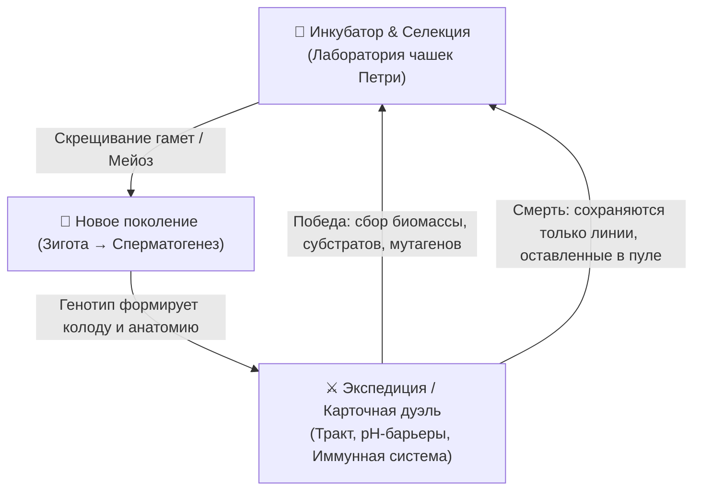

# 🧬 SPERMO — Game Design Concept (Научный Био-Рогалик)

> **Жанр:** Генетический симулятор селекции + Карточный дуэльный баттлер (Mewgenics × Hearthstone × Реальная цитология и генетика)  
> **Сеттинг:** Микромир репродуктивной биологии, клеточной биохимии и иммунологии. Без магии — только жесткий молекулярный реализм, дарвиновский отбор и мутагенез.

---

## 🔬 Ключевая концепция и игровой цикл (Core Loop)

Игра разделена на две взаимосвязанные фазы:



---

## 1. Научная генетика и селекция (Слой Mewgenics)

В отличие от упрощенных RPG-статов, все свойства особи определяются реальными законами молекулярной генетики.

### 1.1. Кариотип, Аллели и Хромосомы
* У особей есть хромосомный набор (например, упрощенный гаплоидный набор $1n = 6$ хромосом).
* **Сперматозоид — гаплоид ($1n$)**, несущий один набор аллелей.
* **Скрещивание (Селекция):**
  * В лаборатории ты сливаешь отобранный сперматозоид с яйцеклеткой-донором ($1n$), образуя **диплоидную зиготу ($2n$)**.
  * Зигота делится и проходит **мейоз (сперматогенез)** для создания пула новых гаплоидных бойцов ($1n$).
  * **Кроссинговер (Crossing-over):** во время профазы мейоза I гомологичные участки хромосом обмениваются участками. Сцепленные гены могут разделиться с вероятностью, пропорциональной расстоянию между ними на хромосоме!

### 1.2. Типы наследования
* **Полное доминирование (Аллели A / a):** например, аллель плотной акросомы доминирует над дефектной.
* **Неполное доминирование:** скрещивание особи с длинным жгутиком ($L_1 L_1$) и коротким ($L_2 L_2$) дает промежуточную среднюю длину ($L_1 L_2$).
* **Кодоминирование:** рецепторы мембраны (как группы крови AB0) — экспрессируются оба белка одновременно.
* **Летальные аллели и Инбредная депрессия:**
  * Слишком частое близкородственное скрещивание в чашке Петри приводит к гомозиготности по летальным рецессивным мутациям (гибель зародышей, бесплодие, микроцефалия головки).
* **Гетерозис («Гибридная сила»):** скрещивание двух далеких чистых линий дает взрыв жизнеспособности и энергоэффективности у гибридов первого поколения.

### 1.3. Мутагенез (Реальные типы мутаций)
Мутации возникают под воздействием факторов среды (радиация, окислительный стресс / АФК, токсины, температура):
1. **Точковые мутации (SNP):**
   * *Миссенс:* изменение структуры белка (например, акрозин разъедает барьеры на 20% сильнее, но требует больше АТФ).
   * *Нонсенс:* преждевременный стоп-кодон (полная потеря функции органеллы, дефект жгутика).
2. **Хромосомные аберрации:**
   * *Дупликация гена:* удвоение гена цитохрома дает мутацию «Второй ряд митохондрий» (+2 базовых АТФ).
   * *Инверсия / Транслокация:* перемешивание генов меняет доступность карт в бою.
3. **Эпигенетика (Метилирование ДНК):**
   * Особь, прошедшая экстремальную кислотную среду, передает потомству «стрессовую метку»: её потомки первого поколения рождаются с временной экспрессией генов протонных помп ($H^+$-ATP-азы).

---

## 2. Цитология и Анатомия бойца (Анатомический конструктор)

Боец состоит из трёх анатомических зон, каждая из которых определяет параметры и пулы карт:

```
      [ ГОЛОВКА ]               [ ШЕЙКА / СРЕДНИЙ ОТДЕЛ ]         [ ХВОСТ (АКСОНЕМА) ]
 ┌──────────────────────┐      ┌─────────────────────────┐      ┌───────────────────────~~~~
 │  • Акросома (ферменты)│ ───  │  • Митохондриальная     │ ───  │  • Микротрубочки 9+2
 │  • Ядро (Протамины)   │      │    спираль (Синтез АТФ) │      │  • Динеиновые ручки
 │  • Мембранные рецепторы│     │  • Центриоль (структура)│      │  • Частота биения (Гц)
 └──────────────────────┘      └─────────────────────────┘      └───────────────────────~~~~
```

1. **Головка (Ядро + Акросома):**
   * Отвечает за защиту ДНК, броню и **ферментный арсенал** (карты урона, растворения и пробития защитных мембран).
   * Ферменты: *Гиалуронидаза*, *Акрозин*, *Фосфолипаза*, *Нейраминидаза*.
2. **Шейка / Средний отдел (Митохондрии):**
   * Отвечает за **пул и генерацию АТФ** (энергия/мана для карт).
   * *Механика окислительного фосфорилирования:* можно разогнать выработку АТФ, но генерируются **АФК (Активные формы кислорода)**, которые наносят урон собственной мембране и вызывают случайные мутации ДНК прямо во время боя!
3. **Хвост (Жгутик / Аксонема 9+2):**
   * Отвечает за **скорость, уклонение, инициативу хода и реотаксис** (способность плыть против течения жидкостей).
   * Динеиновые моторы определяют силу физических ударов жгутиком и частоту биения (Гц).

---

## 3. Карточный бой (Слой Hearthstone в био-микромире)

Бой происходит в микрофлюидном поле / просвете тракта против элементов иммунной системы и патогенов.

### 3.1. Ресурсная система: АТФ и pH
* **АТФ (Аденозинтрифосфат):** аналог маны. Растет каждый ход (1, 2, 3... 10 АТФ) за счет гликолиза и митохондрий.
* **Шкала pH среды:**
  * У каждой зоны свой pH (влагалище: кислый pH 3.8–4.5; матка: слабощелочной pH 7.2–8.0).
  * **Оптимум pH у ферментов:** Карта «Акрозин» наносит 100% урона только при pH 7.5, а в кислой среде её эффект падает, если не активированы защитные щелочные буферы.

### 3.2. Стол боя и Типы карт

Игрок управляет своим сперматозоидом (Герой) и может вызывать на стол микро-союзников и выкладывать биохимические реакции:

| Класс карт | Биологический аналог | Механика в бою |
| :--- | :--- | :--- |
| **Ферменты (Spells / Реакции)** | Гиалуронидаза, Кислотная протеаза | Нанесение урона, растворение защитных муциновых щитов, лизис клеток врага |
| **Симбионты (Minions)** | Лактобактерии (*L. crispatus*), полезная микрофлора | Выставляются на поле, генерируют молочную кислоту, принимают урон на себя |
| **Мембранные реакции (Secrets)** | Холестериновый отток, деполяризация | Срабатывают скрытно при атаке врага (например: парирование антитела) |
| **Метаболические стимуляторы** | Всплеск цАМФ, $Ca^{2+}$-вход | Временный разгон АТФ и скорости ценой накопления токсинов |

### 3.3. Ключевые научные механики (Keywords)
* **Капацитация (Capacitation):** Карты/состояния, активирующиеся только после снятия холестериновой оболочки. Дает состояние *Гиперактивации* (двойной урон ценой потери стабильности).
* **Опсонизация (Opsonization):** Антитела метят твои клетки. Помеченная клетка получает удвоенный урон от макрофагов.
* **Хемотаксис (Chemotaxis):** Карты притяжения к градиенту прогестерона — позволяют выбирать конкретную цель атаки в обход провокаторов.
* **Аутофагия (Autophagy):** Уничтожение поврежденной митохондрии для мгновенного исцеления и получения 2 свободных АТФ.
* **Лизис (Lysis):** Мгновенное разрушение мембраны врага при накоплении критического осмотического давления.

### 3.4. Враги (Иммунологический бестиарий)
* **Нейтрофилы и НЭТы (NETs — Neutrophil Extracellular Traps):** выбрасывают липкую сеть из собственной ДНК, парализуя движение.
* **Макрофаги:** гигантские танки с механикой фагоцитоза (пожирают миньонов и восстанавливают свое здоровье).
* **Иммуноглобулины (Антитела IgA / IgG):** связывают жгутики, склеивая клетки между собой (агглютинация).
* **Система комплемента:** белковый каскад, который собирает МАК (мембраноатакующий комплекс) — таймер смерти на несколько ходов.

---

## 4. Лаборатория селекционера (Мета-прогрессия)

Между экспедициями игрок работает с биореактором:
1. **Спермограмма (Анализ популяции):**
   * *Концентрация*, *Подвижность (категории A, B, C)*, *Морфология по Крюгеру* (% нормальных форм).
2. **Методы искусственного отбора:**
   * **Свим-ап тест (Swim-up):** прогон популяции через питательную среду — выживают только особи с максимальной подвижностью (хвостом).
   * **Градиент плотности (Центрифугирование):** отделение дефектных клеток с фрагментацией ДНК.
   * **Микрофлюидная сортировка:** ручной выбор особей по уникальным белковым маркерам.
3. **Криоконсервация:**
   * Заморозка ценного генетического материала (элитных линий) в жидком азоте, чтобы не потерять породу при неудачном рейде.

---

## 5. Визуальный стиль и звук

* **Визуал:** Микроскопическая оптика — темное поле (Darkfield microscopy) или фазово-контрастная микроскопия. Глубокий темный фон, полупрозрачные клеточные мембраны, флуоресцентное свечение белков (GFP — зеленый, RFP — красный), преломление света в цитоплазме.
* **Интерфейс:** Стилизация под экран профессионального конфокального лазерного микроскопа и лабораторный секвенатор ДНК.
* **Звук:** Глухие органические гидродинамические звуки, пульсация цитоплазмы, шипение химических реакций, щелчки секвенатора.
