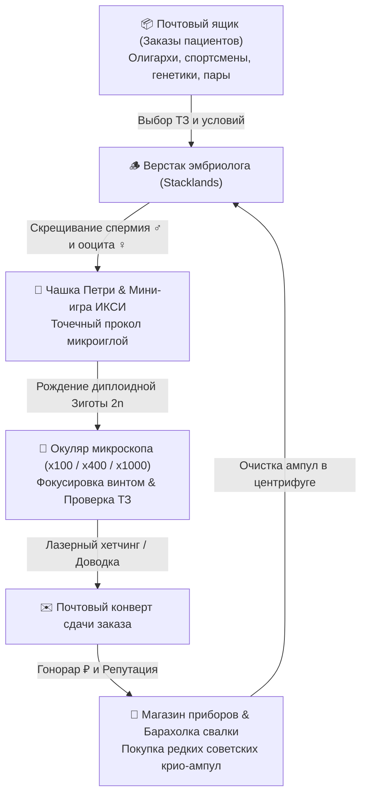

# 🧬 SPERMO — Game Design Concept (Симулятор Клиники ЭКО и Био-Утиля)

> **Жанр:** Тактильный симулятор лаборатории эмбриологии + Селекция генома + Физика карточек (*ReStory* × *Stacklands* × Реальная репродуктивная биология)  
> **Сеттинг:** Уютная подпольная клиника эмбриологии в мире позднего биопанка. Никакой магии — только строгая клеточная цитология, молекулярная генетика, стандарты ВОЗ и списанные архивные ампулы 1980-х годов.

---

## 🔬 Ключевой игровой цикл (Core Loop)

---

## 1. Репродуктивная биология: Гаметы ($1n$) vs Зиготы ($2n$)

### 1.1. В чём разница и зачем нужны Зиготы?
* **Гаметы ($1n$ гаплоидные клетки)**:
  * Сперматозоиды (♂) и Ооциты (♀).
  * Несут одинарный набор хромосом (CH1–CH4).
  * Не способны самостоятельно делиться. Они служат **родительским племенным материалом** вашей лаборатории.
* **Зиготы ($2n$ диплоидные зародыши)**:
  * Образуются в результате слияния генетического материала спермия и яйцеклетки при процедуре **ИКСИ (Интрацитоплазматическая инъекция сперматозоида)**.
  * Пациенты клиники бесплодия, спортивные тренеры и генетики заказывают **именно жизнеспособные Зиготы ($2n$)** для внутриматочной имплантации.
  * Готовая зигота упаковывается в транспортный флакон и сдаётся в почтовый конверт заказчику.

### 1.2. Классификация бластоцист по Гарднеру (Gardner Blastocyst Grading)
Каждая полученная в лаборатории зигота оценивается по международному стандарту Гарднера:
* **4AA (Высший класс)**: Развитая экспандированная бластоциста с идеальной внутриклеточной массой и трофэктодермой. Приносит максимальный гонорар и +10 к репутации. Получается при идеальном проколе в мини-игре ИКСИ.
* **3AB (Хороший класс)**: Высокая жизнеспособность, допускается большинством коммерческих клиентов.
* **2BB (Удовлетворительный класс)**: Базовый зародыш без явных пороков.
* **1CC (Низкий класс)**: Риск дегенерации, принимается только серыми подпольными биохакерами на опыты.

### 1.3. Лабораторные критерии ВОЗ (6-е издание Руководства по исследованию эякулята)
* **Частота биения жгутика ($f_{flag}$)**: измеряется в Гц (норма: 25–45 Гц).
* **Амплитуда латерального смещения головки (ALH)**: размах колебаний в мкм (норма: 2.0–5.0 мкм).
* **Строгая морфология по Крюгеру (%)**: процент клеток с идеальной формой головки, акросомы и шейки (норма: $\ge 4\%$, в элитных линиях $\ge 85\%$).
* **Фрагментация ДНК (TUNEL %)**: процент одно- и двунитевых разрывов ДНК (норма: $< 15\%$).
* **Митохондриальный мембранный потенциал ($\Delta\Psi m$)**: показатель выработки АТФ (норма: $-140$ ... $-220$ мВ).
* **Окислительный стресс (АФК %)**: повреждение мембран активными формами кислорода.

---

## 2. Прогрессия микроскопов и сокрытие параметров

Чтобы мотивировать игрока развивать клинику, характеристики клеток скрыты до покупки соответствующего уровня оптики:

| Уровень прибора | Модель | Увеличение | Открываемые параметры |
| :--- | :--- | :--- | :--- |
| **Уровень 1** | *Базовая оптическая лупа* | **x100** | Имя, класс, частота биения жгутика (Гц), амплитуда ALH, уровень инбридинга. Цитология и кариотип скрыты. |
| **Уровень 2** | *Olympus BX53 (Фазовый контраст)* | **x400** | Сила акрозина, холестериновый барьер мембраны, морфология по Крюгеру (%), фрагментация ДНК (%), АФК %, грейд Гарднера (4AA). |
| **Уровень 3** | *Zeiss Axio (Спектральный FISH)* | **x1000** | Полная молекулярная формула 4 хромосом (CH1–CH4), аллели, скрытые рецессивные мутации, 100% точность совпадения с ТЗ. |

---

## 3. Тактильные мини-игры рабочего места (*ReStory* Style)

1. **Мини-игра фокусировки микроскопа**:
   * При установке образца изображение в окуляре изначально расфокусировано.
   * Игрок вращает макрометрический винт кнопками `[◄]` и `[►]` под окуляром.
   * В момент совпадения фокуса раздаётся приятный «щелчок», линза становится кристально прозрачной, а прибор выдаёт диагностический протокол.
2. **Мини-игра ИКСИ в чашке Петри**:
   * При скрещивании спермия и ооцита активируется микроманипулятор.
   * Игла осциллирует перед zona pellucida яйцеклетки.
   * Игрок нажимает `[Space]` или кликает по кнопке `[⚡ ПРОКОЛ]`. Попадание в зелёную зону Sweet Spot даёт эмбриону высший балл Гарднера **4AA** и снижает фрагментацию ДНК.
3. **Регулятор оборотов центрифуги**:
   * 1500 RPM (щадящая седиментация).
   * 3000 RPM (стандартное разделение фракций).
   * 6000 RPM (градиент плотности Перколла при покупке апгрейда — очищает мёртвые клетки и даёт +10% к Крюгеру восстановленного образца).
4. **Лазерный модуль Zilos**:
   * Обработка ооцитов и эмбрионов лазерным импульсом истончает оболочку (+15% к шансу прикрепления).

---

## 4. Кариотип и Локусы (Модель Mewgenics)

Геном особи состоит из 4 ключевых хромосомных локусов:
* **CH1 (Головка & Акросома)**:
  * `ACR_HYPER` — Гиперактивация и мощный акрозин (+12 к урону/пробитию).
  * `ACR_TITANIC` — Титанический таранный щит (+20 к прочности).
  * `ACR_DRILL` — Буровая форма спиральной головки.
* **CH2 (Шейка & Метаболизм)**:
  * `MITO_CRYO` — Морозостойкие ферменты крио-адаптации.
  * `MITO_TURBO` — Сдвоенная спираль митохондрий (+4 базовых АТФ).
* **CH3 (Жгутик & Аксонема 9+2)**:
  * `FLA_HYPER` — Удвоенная частота биения жгутика (до 50 Гц).
  * `FLA_HEAVY` — Утолщённый жгутик с усиленными динеиновыми ручками.
* **CH4 (Мембрана & Рецепторы)**:
  * `MEM_IMMUNE` — Камуфляж от антител и нейтрофилов.
  * `MEM_CHOL` — Плотный холестериновый панцирь.
